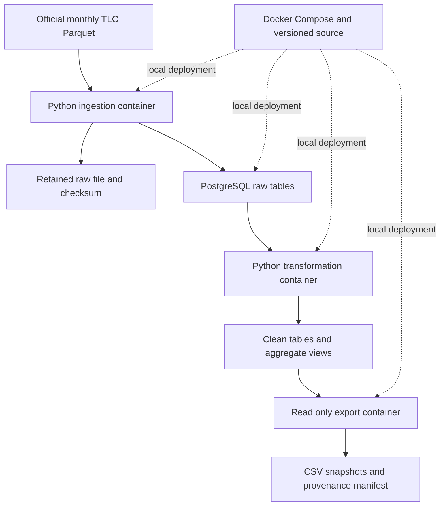

# Architecture and implementation decisions

The selected assignment is Task 1, the batch architecture. There is no frontend or model training requirement.

Python 3.12.9 and PostgreSQL 17.4 images implement the Phase 1 design. One application image has three independently invoked services. Ingestion downloads the official source, validates its schema and million-row minimum, retains the full Parquet source, and streams eight selected fields into PostgreSQL with 100,000-row Arrow batches and COPY. Raw rows are identified by source month and physical row number. Source duplicates remain because matching attributes do not prove that rides are duplicates.

Transformation runs SQL inside a transaction, creates the cleaned source partition, records mutually exclusive rejection counts and exposes daily, hourly and quarterly aggregate views. Export uses a reader role, a read-only repeatable-read transaction, and atomically publishes a UUID snapshot with checksums. A latest pointer identifies the newest complete export operation. It does not mean that the calendar quarter is complete; that is a separate manifest flag.

Google Colab is an optional exploration environment. A notebook is supplied, but runtime ingestion, transformation and delivery run locally. GitHub is the intended source host; the portable Git bundle contains the local history until the owner publishes it. No cloud deployment is used.

## Reliability and recovery

Temporary downloads are renamed only after validation. Cached files are checked against recorded SHA-256 values. Three bounded download attempts address transient failures. Database changes use transactions and a shared advisory lock. Re-ingesting invalidates the transformed source fingerprint; export rejects stale processing. Repeated monthly loads replace the month rather than appending it. A failed export does not replace latest.json. The next successful run recovers naturally. Existing snapshots are retained for provenance; the operator decides retention and deletion.

## Scale and limits

Arrow batching limits Python loading memory, while PostgreSQL performs grouping. This is a single-machine implementation, with one database and no distributed workers, replicas or high availability. Large source partitions increase disk use, transaction size and aggregate query time; SQL views are computed when queried. Logical source partitions and the pickup index support this dataset, but physical table partitioning and materialized aggregates are future improvements. Timing in evidence is environment-specific and does not establish a production SLA.

## Security and governance

The database has no published host port. Its network is internal; only ingestion also joins a network with outbound access. Pipeline and reader accounts are non-superusers. Application containers drop capabilities, use read-only roots and a non-root UID. Local .env credentials are generated randomly, ignored by Git and excluded from the ZIP. Raw public data remain available for audit; downstream delivery contains aggregates and zone IDs. Exact trip times can still be sensitive, so use appropriate local access controls. Environment variables and Docker volumes are adequate for this local prototype; managed secrets, TLS, encrypted disks, audited access and automated backups are future operational requirements.

## Data quality rules

First matching rejection wins, allowing raw = accepted + rejected. Reject missing timestamps; pickups outside the named source month; nonpositive duration or duration above 24 hours; missing, negative or nonfinite distance, fare or total amount; and zone IDs outside 1–265. These are declared analytical choices, not TLC validation standards. Refunds and unusual journeys can be excluded and should be reviewed for another use case. Zero-distance trips are retained. Missing, nonpositive and nonfinite passenger counts are retained and flagged as unknown in hourly aggregates. Source timestamps remain NYC local wall time without timezone inference. Dollar totals exclude cash tips, following the source definition, so total_revenue is an observed-charge measure.

## Schedule

Monthly ingestion and transformation operate on an explicitly named source month. Quarterly delivery uses --require-complete-quarter after all three source months are loaded and transformed. A January-only run exports a clearly marked partial quarter. scripts/scheduled_batch.py supports monthly host scheduling with the publication lag; setup instructions show Task Scheduler and cron. Host scheduling must be enabled by the operator and is not automatically registered.
